# AB IT Multimedia — CSE 489 Assignment 2

An Android app (Kotlin, XML Views) with a navigation drawer and four features: a
**Broadcast Receiver** flow across three Activities, **Image Scale** (pinch-to-zoom on an
internet photo), **Video** and **Audio** playback. Built for CSE 489 Assignment 2 at BRAC University.

<p>
  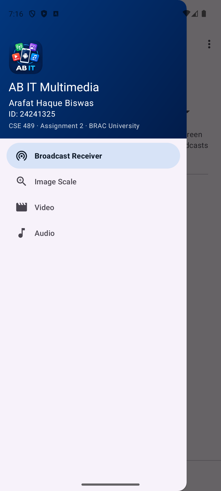
  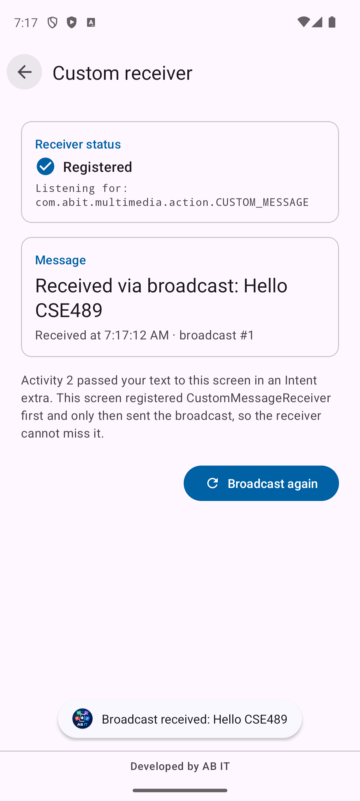
  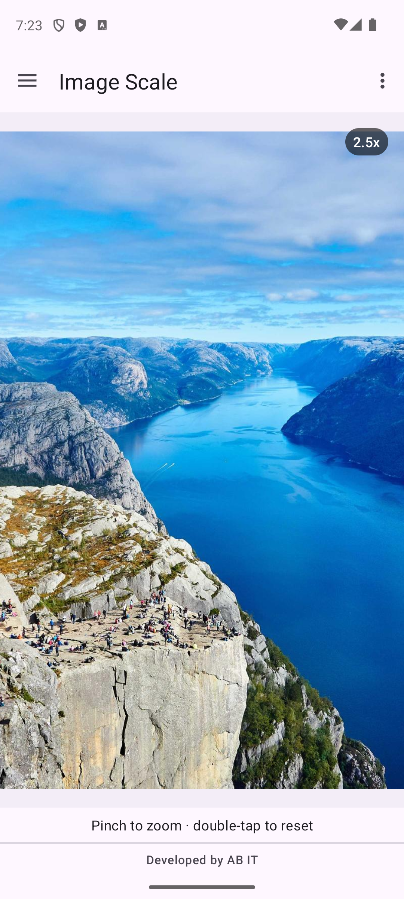
  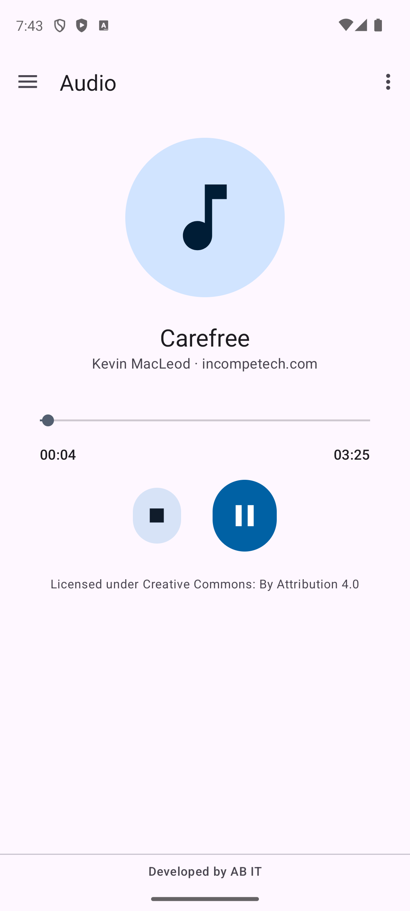
</p>

## Student information

| | |
|---|---|
| Name | Arafat Haque Biswas |
| Student ID | 24241325 |
| University | BRAC University |
| Course | CSE 489 — Mobile Application Development |
| Assignment | Assignment 2 |
| Branding | AB IT (footer: “Developed by AB IT”) |

## Features

**Navigation drawer** with exactly four items, in order: Broadcast Receiver, Image Scale, Video,
Audio. The toolbar title follows the screen, the current item is highlighted, top-level screens
show the hamburger icon, and Back closes an open drawer first. The drawer header shows the AB IT
logo, the student name and ID; tapping it (or *About* in the toolbar menu) opens the About screen.

**A. Broadcast Receiver**
1. *Selection screen* — a Spinner (from a string-array) with “Custom broadcast receiver” and
   “System battery notification receiver”, and a Proceed button that starts Activity 2 with an
   explicit Intent. The selection survives rotation.
2. *Activity 2, custom* — a “Message to broadcast” text field (blank input is rejected inline;
   the keyboard's Send key works too). The text goes to Activity 3 in an Intent extra.
3. *Activity 2, battery* — live battery percentage, progress bar, charging status and update time
   from `Intent.ACTION_BATTERY_CHANGED`. The receiver is registered only while the screen is
   visible; the sticky broadcast fills the screen immediately. Next opens Activity 3.
4. *Activity 3, custom* — registers `CustomMessageReceiver` (`ContextCompat.RECEIVER_NOT_EXPORTED`),
   **then** sends a package-restricted broadcast with the text, and shows
   “Received via broadcast: …”, the time, a Toast and a Logcat entry. *Broadcast again* re-sends.
   Rotation keeps the message and does not broadcast again.
5. *Activity 3, battery* — only a note: nothing further happens for the battery option.

**B. Image Scale** — a 2000 × 1300 photo loaded with Coil 3 into a custom `ZoomableImageView`
(`ScaleGestureDetector` + `Matrix`): pinch around the fingers (1x–5x), one-finger pan while zoomed
(kept inside the view), double-tap to zoom to 2.5x / reset. Shows a loading indicator, the zoom
level, the hint “Pinch to zoom · double-tap to reset”, and an error state with Retry.

**C. Video** — a bundled MP4 in a `VideoView` with `MediaController`: correct aspect ratio, loading
indicator, friendly error message, the position is remembered when the screen stops and restored
when you return, playback continues through rotation, and nothing plays behind another screen.

**D. Audio** — a bundled MP3 played by `MediaPlayer` (`AudioAttributes.USAGE_MEDIA`) owned by
`AudioPlayerViewModel`: Play/Pause, Stop, seek bar, title, elapsed/total `mm:ss`. Playback survives
rotation, pauses when you leave the screen, and resets when the track ends.

**Audio and video never play at the same time** — `PlaybackCoordinator` pauses one when the other
starts.

Every screen, including all three broadcast Activities, ends with the shared
**“Developed by AB IT”** footer. Light and dark themes, landscape and edge-to-edge are supported.

## Requirement → file map

All Kotlin files are in `app/src/main/java/com/abit/multimedia/`, resources in `app/src/main/res/`.

| Requirement | Where |
|---|---|
| Drawer with the four items | `res/menu/activity_main_drawer.xml`, `res/layout/activity_main.xml` |
| Navigation Component, top-level destinations, toolbar title | `res/navigation/nav_graph.xml`, `MainActivity.kt` (`AppBarConfiguration`, `setupActionBarWithNavController`, `setupWithNavController`) |
| Back closes the drawer first | `MainActivity.kt` (`closeDrawerOnBack`) |
| Student name and ID in the drawer header | `res/layout/nav_header_main.xml`, `MainActivity.setUpDrawerHeader()` |
| About screen | `about/AboutFragment.kt`, `res/layout/fragment_about.xml`, `res/menu/main_overflow.xml` |
| A. Spinner + Proceed | `broadcast/BroadcastFragment.kt`, `res/layout/fragment_broadcast.xml`, `R.array.broadcast_types` |
| Broadcast mode passed between Activities | `broadcast/BroadcastMode.kt` |
| A. Activity 2 (custom text / battery) | `broadcast/BroadcastInputActivity.kt`, `res/layout/content_custom_input.xml`, `res/layout/content_battery_status.xml` |
| Battery receiver, sticky Intent, percentage | `broadcast/battery/BatteryStatusLiveData.kt`, `BatteryStatus.kt`, `BatteryViewModel.kt` |
| A. Activity 3 + custom receiver | `broadcast/CustomReceiverActivity.kt`, `CustomMessageReceiver.kt`, `CustomBroadcast.kt`, `CustomReceiverViewModel.kt` |
| B. Internet image + pinch zoom | `image/ImageScaleFragment.kt`, `image/ZoomableImageView.kt` |
| C. Video | `video/VideoFragment.kt`, `video/PlaybackAwareVideoView.kt`, `video/VideoViewModel.kt`, `res/raw/sample_video.mp4` |
| D. Audio | `audio/AudioFragment.kt`, `audio/AudioPlayerViewModel.kt`, `audio/PlaybackTime.kt`, `res/raw/sample_audio.mp3`, `res/layout-land/fragment_audio.xml` |
| Audio/video coordination | `media/PlaybackCoordinator.kt` |
| Footer watermark | `res/layout/view_footer_watermark.xml` (included by every screen layout) |
| Edge-to-edge insets | `ui/WindowInsetsExtensions.kt` |
| Launcher icon from the AB IT logo | `branding/`, `res/mipmap-*`, `res/drawable/ic_launcher_background.xml` |
| Exported Activities, permissions | `app/src/main/AndroidManifest.xml` |

## Tech stack

Kotlin (AGP built-in Kotlin 2.2), XML Views with ViewBinding, Material 3 for Views, DrawerLayout +
NavigationView, Navigation Component, Fragments, ViewModel + LiveData + StateFlow, coroutines,
native broadcast APIs, `ScaleGestureDetector`/`Matrix`, `VideoView`/`MediaController`/`MediaPlayer`.
No Compose, Hilt, kapt/KSP or Safe Args. All versions are in `gradle/libs.versions.toml`.

| Item | Version |
|---|---|
| Android Gradle Plugin / Gradle wrapper | 9.4.1 / 9.6.0 (Android Studio 2026.2 template defaults) |
| compileSdk / targetSdk / minSdk | 37 / 37 / 24 |
| AndroidX Core / AppCompat / Activity / Fragment | 1.19.1 / 1.8.0 / 1.13.0 / 1.9.1 |
| Lifecycle / Navigation / ConstraintLayout | 2.11.0 / 2.10.2 / 2.2.2 |
| Material Components | 1.14.0 |
| Coil 3 (`coil`, `coil-network-okhttp`) | 3.3.0 |
| JUnit / AndroidX Test JUnit / Espresso (+contrib) | 4.13.2 / 1.3.0 / 3.7.0 |

Coil is pinned to **3.3.0** on purpose: it is the newest release built with Kotlin 2.2, the Kotlin
version built into AGP 9.4.1. Coil 3.4 is built with Kotlin 2.3, and 3.5 and later with Kotlin 2.4,
which the Kotlin 2.2 compiler cannot read.

## Build and run

**Android Studio (2026.2):** open this folder, let Gradle sync, choose a device and press Run.

**Command line** (macOS, JDK and SDK as installed by Android Studio):

```bash
export ANDROID_HOME=~/Library/Android/sdk
./gradlew assembleDebug            # APK: app/build/outputs/apk/debug/app-debug.apk
./gradlew installDebug             # install on the connected device/emulator
./gradlew testDebugUnitTest        # unit tests
./gradlew connectedDebugAndroidTest   # Espresso tests (needs a device; uninstalls the app afterwards)
./gradlew lintDebug                # report: app/build/reports/lint-results-debug.html
```

The Gradle daemon runs on JDK 25, which Gradle downloads automatically (`gradle/gradle-daemon-jvm.properties`).
Image Scale needs internet access; video and audio are bundled and work offline.

## How to test each feature

1. **Drawer** — tap the hamburger or swipe from the left edge. Pick each item: the title and
   highlighted item change. Open the drawer and press Back: only the drawer closes.
2. **Custom broadcast** — on Broadcast Receiver keep “Custom broadcast receiver”, tap Proceed,
   type `Hello CSE489`, tap *Send to receiver* (or the keyboard's Send key). Activity 3 shows
   *Registered* and “Received via broadcast: Hello CSE489” plus a Toast. Rotate: the message stays
   and the count stays at #1. Tap *Broadcast again*: the count goes to #2. Logcat filter:
   `CustomMessageReceiver|CustomReceiverActivity`.
3. **Blank message** — tap *Send to receiver* with an empty field: an inline error appears.
4. **Battery** — choose “System battery notification receiver”, Proceed, then change the battery
   level from a terminal (see below). Next opens Activity 3, which only shows a note.
5. **Image Scale** — wait for the photo, pinch to zoom (label shows e.g. `2.4x`, max `5.0x`), drag
   while zoomed, double-tap to zoom in/reset. To see the error state, clear the app's storage
   (Coil caches the photo), turn off Wi-Fi and mobile data and open Image Scale; turn the network
   back on and tap Retry.
6. **Video** — tap the video to show the controls, play, seek. Press Home and come back: the video
   is paused at the same position. Rotate while playing: playback continues.
7. **Audio** — Play, Pause, Stop, drag the seek bar. Rotate while playing: it keeps playing. Open
   Video and play it: the audio is paused. Seek near the end: the player resets when it finishes.

### Emulator battery testing

```bash
adb shell dumpsys battery unplug          # stop following the host battery
adb shell dumpsys battery set level 42    # the screen updates to 42%
adb shell dumpsys battery set status 2    # 2 = charging -> "Status: Charging"
adb shell dumpsys battery reset           # restore normal behaviour afterwards
```

## Test results

Run on 26 Oct 2026 on the `Pixel_8` emulator (Android 14, API 34):

| Check | Result |
|---|---|
| `assembleDebug` | Successful |
| Unit tests (`testDebugUnitTest`) | **22 / 22 passed** — battery percentage and charging status, broadcast mode parsing, broadcast names, `mm:ss` formatting, playback coordinator |
| Espresso (`connectedDebugAndroidTest`) | **11 / 11 passed** — drawer items/header/navigation/Back, custom broadcast flow with “Hello CSE489”, blank input, battery flow, pinch zoom and limits, double-tap, pan bounds |
| Lint (`lintDebug`) | 0 errors, 3 warnings (newer Gradle 9.8.2 and Coil 3.6.3 exist — both kept on purpose, see above) |

Also checked by hand on the emulator: `dumpsys battery set level 42` updates the screen live; the
battery receiver unregisters when the screen stops; rotation of Activity 3 does not re-send the
broadcast; audio and video never play together (checked with `dumpsys audio`); video position
restored after Home; audio Stop, seek and end-of-track reset; Image Scale error state offline and
Retry once back online; light and dark themes; no crashes in Logcat.

## Media credits

| Media | Source | Licence |
|---|---|---|
| `res/raw/sample_video.mp4` — *Sintel* trailer, 854×480 H.264/AAC, 52 s, 4.4 MB | © Blender Foundation, [durian.blender.org](https://durian.blender.org) (downloaded from download.blender.org) | CC BY 3.0 |
| `res/raw/sample_audio.mp3` — “Carefree”, 3:25, 256 kbps, 6.6 MB | Kevin MacLeod, [incompetech.com](https://incompetech.com) | CC BY 4.0 |
| Image Scale photo (loaded at runtime) | Alexey Topolyanskiy on Unsplash, served by [Lorem Picsum](https://picsum.photos/id/1015/info) | Unsplash licence |

The two suggested sources did not work from this machine (the Google sample bucket returned a
403 error page and soundhelix.com refused the connection), so the files above were used instead.
Each file was checked for HTTP 200, size and real codec before bundling.

## App icon

The supplied logo **`AB IT Multimedia App Icon.png`** was found and is kept, unchanged, as
`branding/ab_it_multimedia_app_icon.png`. `branding/generate_launcher_icons.sh` (ImageMagick)
creates every icon asset from it, as a scripted equivalent of Android Studio's Image Asset wizard:

- adaptive icon (API 26+): the logo as foreground (`mipmap-*/ic_launcher_foreground.webp`), with
  all artwork inside the 66 dp safe zone, on a navy gradient matching the logo
  (`drawable/ic_launcher_background.xml`);
- themed icon layer (API 33+): `mipmap-*/ic_launcher_monochrome.webp`, made from the logo's own
  white artwork and lettering;
- legacy square and round icons for API 24–25, a 512 × 512 Play Store icon
  (`app/src/main/ic_launcher-playstore.png`), and the in-app logo `drawable-nodpi/ab_it_logo.webp`
  used in the drawer header and About screen.

The logo's proportions are preserved; only the white page around the rounded square is made
transparent. Run `./branding/generate_launcher_icons.sh` again after replacing the source file.

## Screenshots

All screenshots are in [`docs/images/`](docs/images) (Pixel 8 emulator).

| | | | |
|---|---|---|---|
| 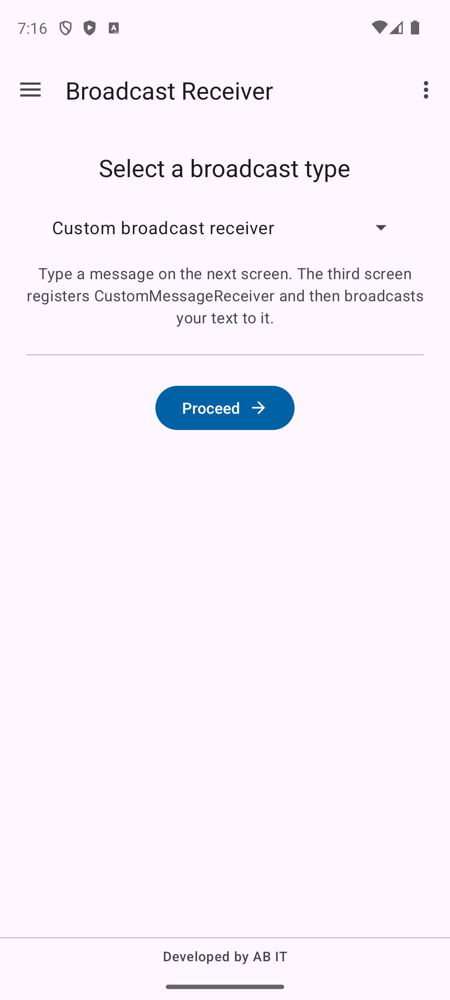<br>Broadcast Receiver | <br>Drawer | 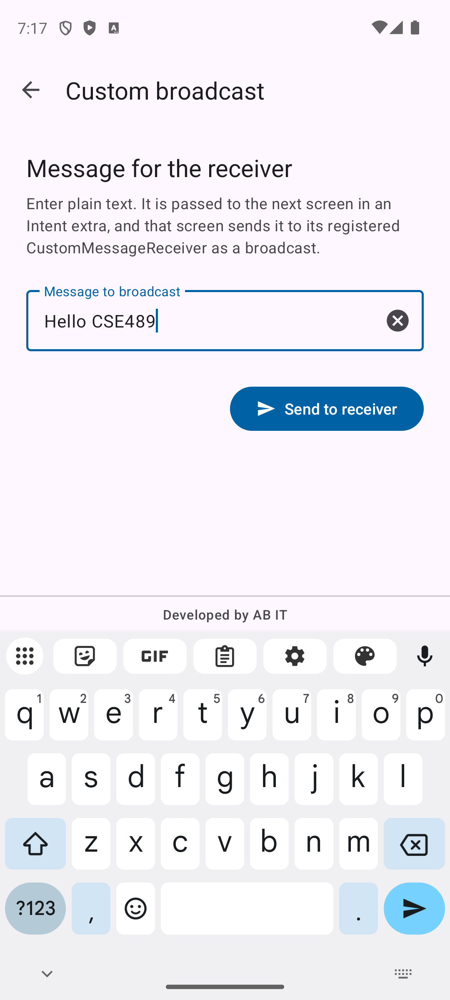<br>Activity 2 — custom | <br>Activity 3 — received |
| 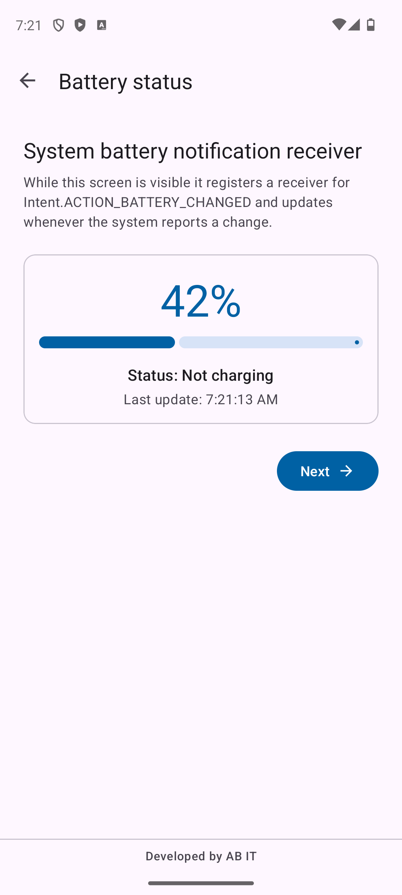<br>Activity 2 — battery (42%) | 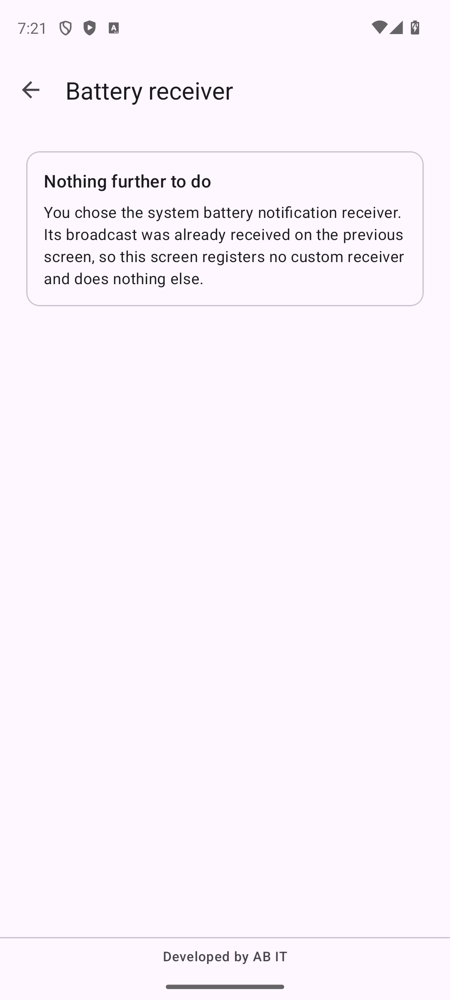<br>Activity 3 — battery | 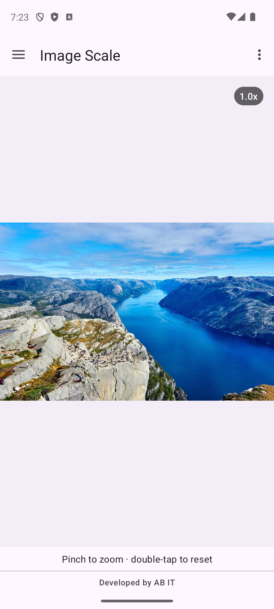<br>Image Scale | <br>Zoomed 2.5x |
| 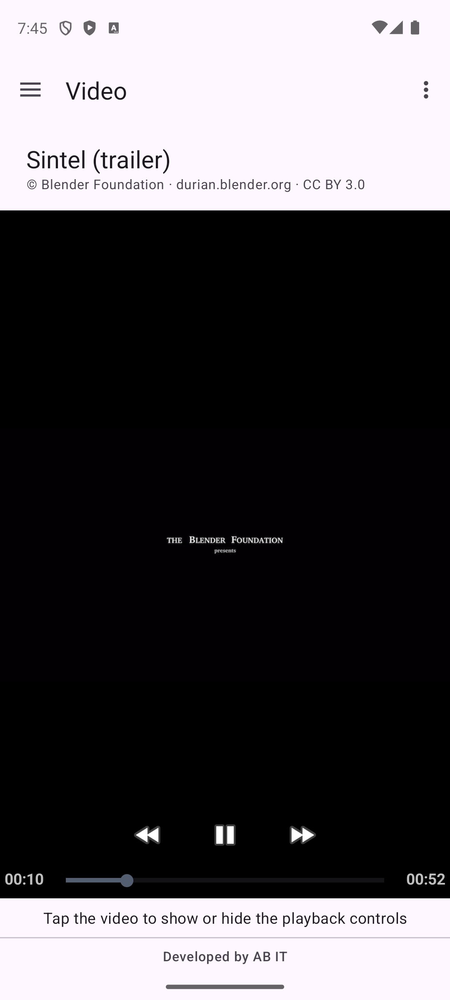<br>Video | <br>Audio | 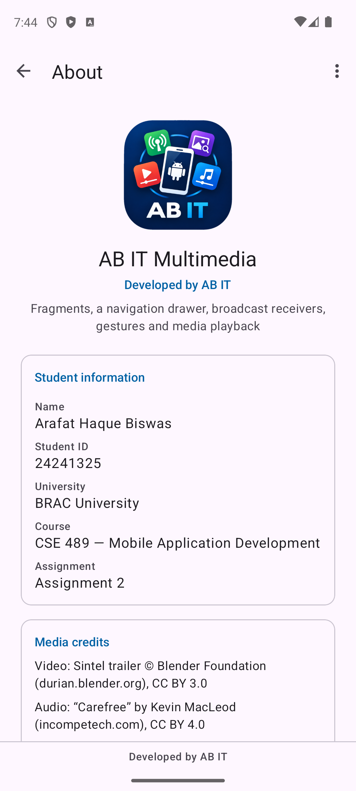<br>About | 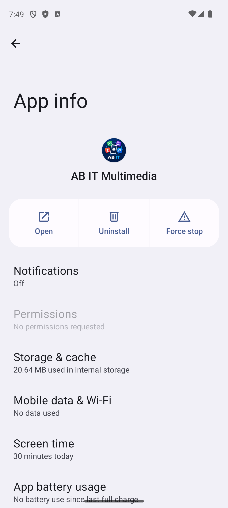<br>Installed icon and name |
| 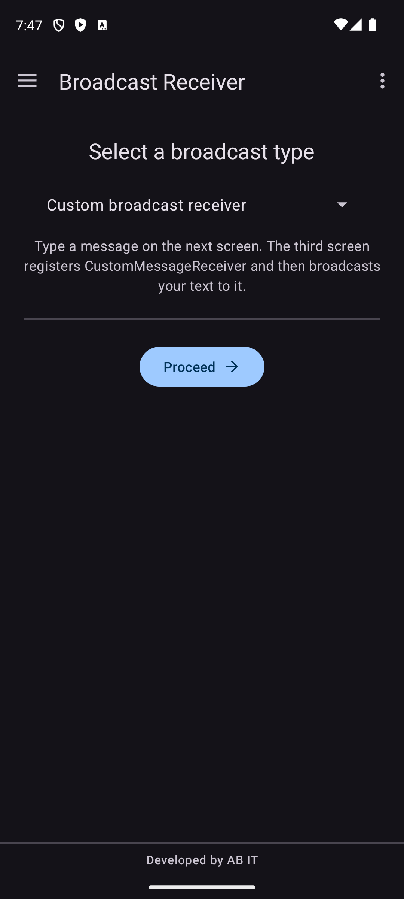<br>Dark theme | 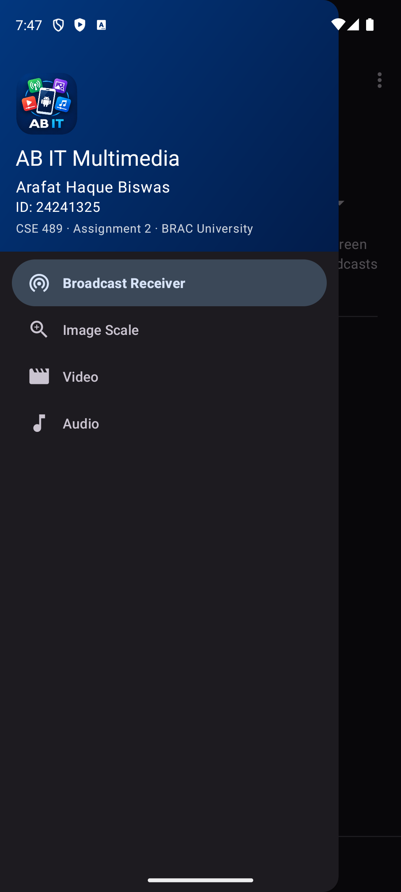<br>Dark drawer | 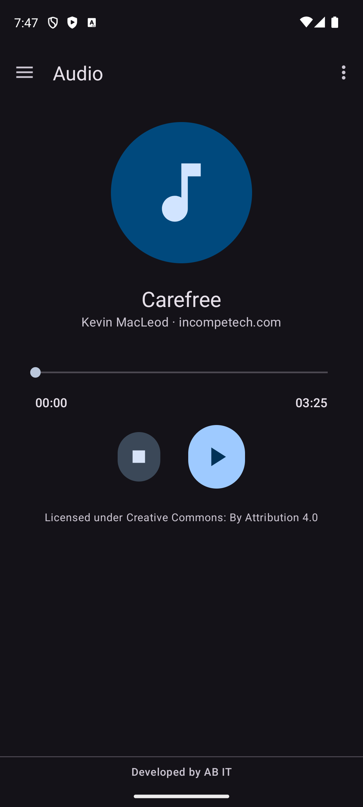<br>Dark audio | 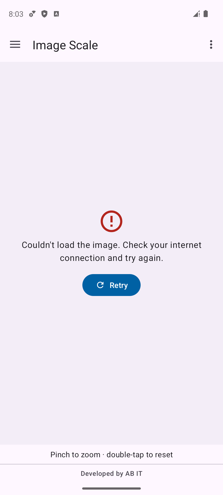<br>Image Scale offline |

Landscape: [Activity 3](docs/images/05_custom_receiver_landscape.png),
[Audio](docs/images/12_audio_landscape.png).

## Known limitations

- **Image Scale needs internet.** Without it, the error message and Retry button are shown.
- **Paused video is black** until Play is pressed: VideoView draws no frame before playback starts.
  The saved position is still restored and shown on the controls.
- The zoom level of Image Scale is reset after rotation (the photo is fitted to the new screen).
- While the MediaController is visible, its window receives every touch, so the first tap only
  hides it. It hides itself after 3 seconds.
- Audio focus is not requested, so music from other apps is not paused (not required).
- Tested on one emulator (Pixel 8, API 34). Not tested on a physical phone or on API 24–25, where
  the legacy icons would be used.
- `CSElab` was empty when work started, so the Empty Views Activity project was recreated with
  Android Studio 2026.2's template settings (see the first commit).
